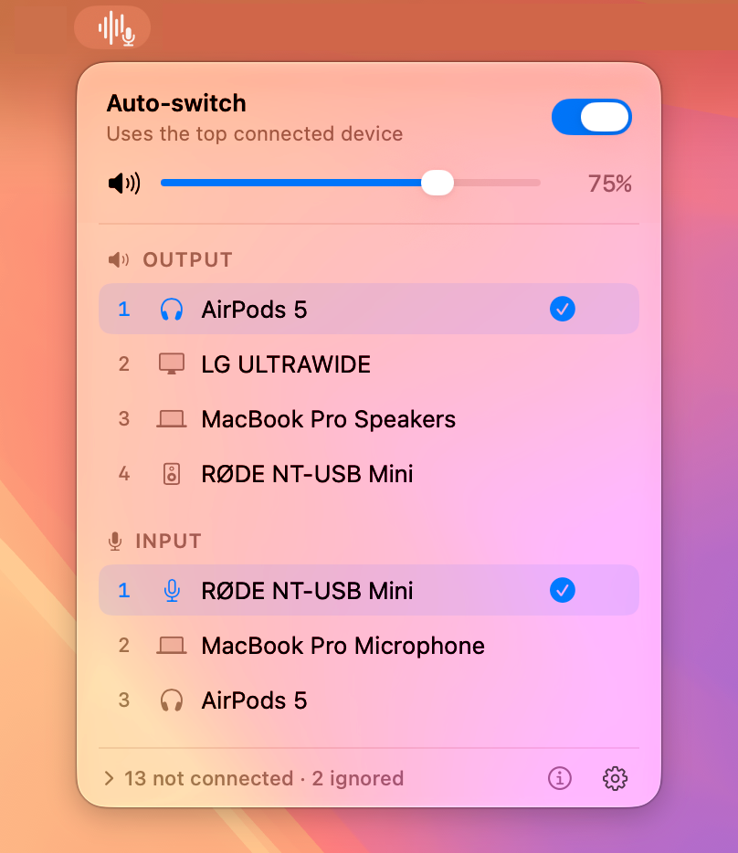

# Audio Priority Bar

<p align="center">
  
</p>

A native macOS menu bar app that keeps your Mac on the audio devices you prefer. Rank your outputs and your microphones once; the app always uses the highest-ranked device that is connected.




## Features

- **One ranked list per direction**: speakers and headphones share a single Output list, microphones have an Input list. The top connected device of each list is used.
- **Enforced, not just suggested**: with Auto-switch on, the app switches back if macOS or another app changes the device, including the wrong fallback when Bluetooth headphones change profile for a call.
- **Auto-switch toggle**: turn it off to pick devices yourself by clicking them.
- **Device memory**: every device you have connected is remembered with its rank, so headphones take their place again when they reconnect. Open "not connected · ignored" to rank devices that are not plugged in.
- **Ignore**: hide devices you never want used (virtual devices, a phone microphone).
- **Drag to reorder**, volume slider with scroll-wheel support, mute indicators.

## Installation

### Requirements
- macOS 13.0 (Ventura) or later

### Build from Source

1. Clone the repository:
   ```bash
   git clone https://github.com/nhershy/AudioPriorityBar.git
   cd AudioPriorityBar
   ```

2. Build using the build script:
   ```bash
   ./build.sh
   ```

3. The app will be at `dist/AudioPriorityBar.app`. Copy it to your Applications folder:
   ```bash
   ditto dist/AudioPriorityBar.app /Applications/AudioPriorityBar.app
   ```

Or open `AudioPriorityBar.xcodeproj` in Xcode and build with ⌘R.

## Usage

### Ranking devices

- **Drag a device** up or down to change its rank. The change applies immediately.
- A device you connect for the first time starts at the **bottom** of its list. Drag it up if it should win.
- Reordering only moves the devices you can see; devices that are not connected keep their rank.

### Auto-switch

| Auto-switch | Behavior |
|-------------|----------|
| **On** | The highest-ranked connected output and input are always the system defaults. Clicking a device does nothing; change the order instead. Changes made elsewhere (Control Center, System Settings) are reverted. |
| **Off** | Nothing is changed automatically. Click a device to use it. The menu bar icon is shown slashed. |

### Device actions (hover and click •••, or right-click)

- **Ignore**: hide the device and never select it
- **Stop Ignoring**: bring it back (ignored devices are listed under "not connected · ignored")
- **Forget Device**: remove a disconnected device from memory

### Not connected · ignored

Click the summary at the bottom left to also show:
- remembered devices that are not connected, greyed out with a "last seen" time, at their rank
- ignored devices

Launch at Login and Quit are in the gear menu.

## How It Works

1. **Device discovery**: CoreAudio enumerates devices and reports every change.
2. **Storage**: the ranked lists, ignored devices and known devices are stored in UserDefaults by device UID. A device whose UID changes (a USB device moved to another port, an AirPlay session) takes over the entry of a disconnected device with the same name.
3. **Enforcement**: on every device or default-device change, 1.5 seconds after the last change, and after wake from sleep, the app sets the system default to the highest-ranked connected device that is not ignored.
4. **Upgrading**: settings from the earlier Speakers / Headphones / Manual version are converted on first launch (headphones are placed above speakers). The old settings are left in place.

## Tests

```bash
Tests/run.sh
```

Runs the tests for the ranking, reordering, UID-change and migration logic.

## Project Structure

```
AudioPriorityBar/
├── AudioPriorityBarApp.swift    # App entry, MenuBarExtra, menu bar icon
├── Models/
│   ├── AudioDevice.swift        # Device model and row icon
│   └── Headphones.swift         # Headphone name keywords (icons, migration)
├── Services/
│   ├── AudioManager.swift       # Central state, enforces the ranked order
│   ├── AudioDeviceService.swift # CoreAudio wrapper
│   ├── PriorityManager.swift    # UserDefaults persistence
│   ├── PriorityLogic.swift      # Pure ranking / migration logic
│   └── LaunchAtLoginManager.swift
└── Views/
    ├── MenuBarView.swift        # Main popover UI
    └── DeviceListView.swift     # Device rows and drag-to-reorder
Tests/
├── PriorityLogicTests.swift
└── run.sh
```

## Contributing

Contributions are welcome! Please feel free to submit a Pull Request.

## License

MIT License - see [LICENSE](LICENSE) for details.

## Acknowledgments

Built with SwiftUI and CoreAudio for macOS.
